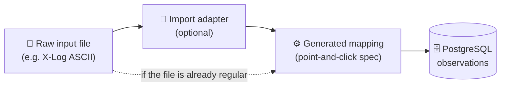
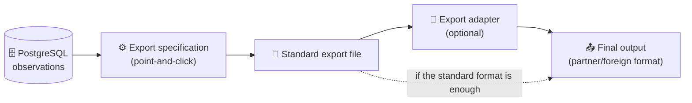
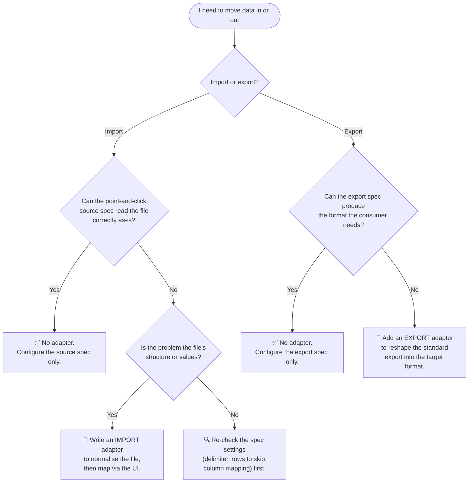
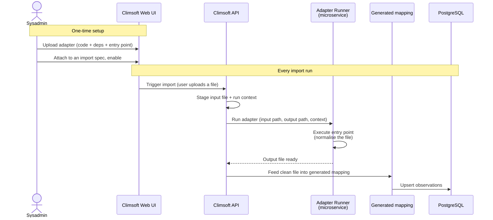
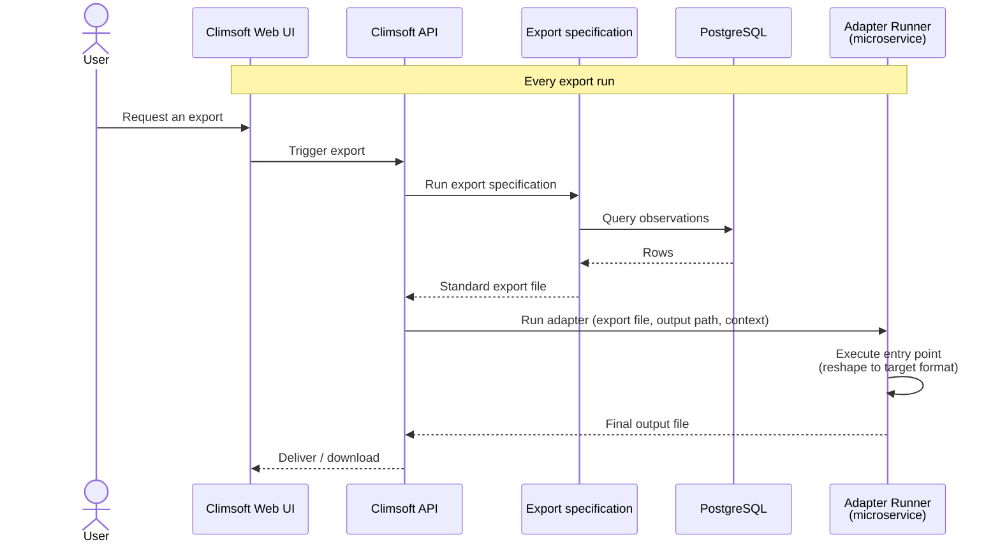
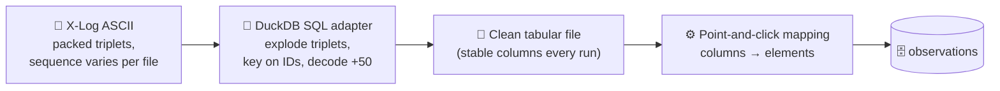

# Climsoft Web Adapters — What They Are and When to Use Them
# Overview

*A plain-language guide to import/export adapters: the problem they solve, where
they sit in the pipeline, and how to decide whether you need one.*

> **In one line:** the point-and-click specification is the *general* path;
> an adapter is the *particular* path for data too irregular to describe by
> point-and-click. Most data never needs one.

---

## 1. Why adapters exist

Climsoft Web is built around a clean internal model of an observation (station,
element, time, value, and so on). Getting external data *into* that model, or
Climsoft data *out* to some external format, is a **mapping** problem.

For the common cases you never write code. You use the specification builder in
the web UI to say things like "skip the first 3 rows", "the delimiter is a
semicolon", "column 4 is air temperature", "times are in UTC+3". Those settings
are saved as JSON, and at runtime Climsoft translates them into DuckDB SQL,
executes it in a managed internal DuckDB process, and produces a file ready for
loading into PostgreSQL.

The catch: **that abstraction is deliberately bounded.** It covers regular,
predictable data cleanly, but it can't express every quirk of every real-world
instrument. Stretching it to try would bloat the UI until it was as complicated
as writing code anyway. Situations it can't capture on its own:

- A file whose **measurement sequence changes between runs** (because an
  instrument was added, removed, or reconfigured), so "column N" doesn't reliably
  mean the same thing from one file to the next.
- Encoding rules like an **offset scheme** (e.g. repeated sensors identified by
  adding 50 to a base ID) that must be decoded before mapping.
- Several logical records **packed onto one line**, or other structural oddities.
- On export: a consumer that needs a **specific foreign format** Climsoft's
  exporter doesn't produce out of the box.

An **adapter**, a small piece of user code, is the escape hatch for exactly
these cases. It doesn't replace the mapping; it runs alongside it, absorbing the
irregularity so the point-and-click mapping stays simple.

---

## 2. Where adapters sit: import vs export

An adapter is the same kind of thing in both directions (a **file-in,
file-out** program), but it brackets the mapping stage on **opposite sides**,
because the irregular side differs by direction.

### Import — the adapter runs *before* the mapping

The raw file is the irregular one, so it gets normalised first.



### Export — the adapter runs *after* the export

Climsoft's own clean export is now the intermediate, and the irregular side is
the external target.



Note the dotted line in both: the adapter is **optional and exceptional**, not a
routine stage. Same contract, mirrored position; that is why the workflow
diagram draws the runner as one symmetric box between IN and OUT.

---

## 3. Do you need one?



**Rule of thumb:** if you can describe the transformation to a colleague purely as
"skip these rows, this delimiter, this column is that element", use the UI. If
you catch yourself saying "…except when the logger is in state X, then the
columns mean something else" — that **"except when"** is where an adapter earns
its place.

---

## 4. How an adapter works

Climsoft Web runs your adapter in a managed, sandboxed microservice (the
**Adapter Runner**). You don't manage servers or deployments: that's the "no
DevOps required" promise.

| Aspect | What it means |
|---|---|
| **Interface** | **File in → file out.** The runner hands your code an input file and an output location; you read one and write the other. Nothing else. |
| **Lifecycle** | Upload → attach to a spec → enable. All from the web UI, at runtime, no redeploy. |
| **Context** | The runner passes run context (station, time offset, spec parameters) alongside the file, so the adapter can be spec-driven rather than hard-coded. |

### Fixed conventions per language

Nothing here is configurable. Each runner looks for **one entry-point filename**
and **one dependency file**, both at the root of the adapter you upload. Declared
dependencies are installed on the first run and cached for later runs.

| Language | Entry point | Dependency file |
|---|---|---|
| Python | `main.py` | `requirements.txt` |
| R | `main.R` | `DESCRIPTION` |
| JavaScript | `index.js` | `package.json` |
| DuckDB SQL | `transform.sql` | `extensions.txt` |



On export the sequence mirrors it. The spec runs first, and the adapter has the
last word:



---

## 5. Worked example: X-Log files, where position can't be trusted

LSI LASTEM X-Log loggers pack many measurements onto a single
semicolon-delimited line. After a fixed header (station ID, time, date), the rest
of the line is a stream of **`measurement-id ; process-id ; value` triplets**:

*(spaces added below for readability; the real file has none)*

```text
S ; 000037 ; 00;00;00 ; 15;06;2026 ; 2;3;93 ; 2;4;94 ; … ; #
│   │        │          │            │
│   │        │          │            └─ first triplet → measurement 2 (humidity) ; process 3 (minimum) ; value 93
│   │        │          └─ date  (dd;mm;yyyy)
│   │        └─ time  (hh;mm;ss)
│   └─ station ID
└─ record start marker
```

**The problem: the sequence isn't stable.** When an instrument is added, removed,
or reconfigured during maintenance, that sensor's triplets appear, disappear, or
move, and every triplet after them **shifts position**. Remove the humidity
sensor, and temperature slides into the slots humidity used to occupy:

```text
Before maintenance (humidity sensor fitted)
S ; 000037 ; 00;00;00 ; 15;06;2026 ; 2;3;93 ; 2;4;94 ; 2;2;94 ; 1;3;-21.6 ; 1;4;-20.9 ; 1;2;-21.2 ; … ; #
                                     └────── humidity ──────┘   └───────── temperature ─────────┘
                                      min      max      avg        min         max         avg

After maintenance (humidity sensor removed)
S ; 000037 ; 00;00;00 ; 16;06;2026 ; 1;3;-21.6 ; 1;4;-20.9 ; 1;2;-21.2 ; … ; #
                                     └───────── temperature ─────────┘
                                        min         max         avg
                                     ▲
                                     this position held humidity minimum the day before
```

A mapping keyed on *position* would now read −21.6 °C as humidity. Nothing
errors; the data is simply, silently wrong. And this is precisely the case you
can't rely on catching: it happens whenever maintenance staff reconfigure a
logger without telling the data manager in time.

**The insight: the IDs never change.** `2;3` means humidity-minimum and `1;3`
means temperature-minimum no matter where in the line they sit. So the adapter
ignores position entirely and keys on the **(measurement id, process id)** pair.
A sequence change then becomes a non-event: the same reading is identified
correctly whether it's the first triplet or the twentieth, so an unannounced
maintenance change can't produce erroneous data.

A second quirk needs the same treatment: repeated sensors of one type are
identified by a **`+50` offset** on the base measurement ID (three temperature
probes appear as 1, 51, 101), which must be decoded before mapping.

So a small DuckDB SQL adapter explodes the triplets into rows and decodes the
offset, emitting a plain, regular tabular file whose columns *do* mean the same
thing every time, which the UI can then map by point-and-click.



The three artifacts from this example are available to inspect, one per stage
above:

| Stage | Artifact | What it shows |
|---|---|---|
| Input | [000037202606150000.txt](https://github.com/user-attachments/files/30093242/000037202606150000.txt) | A raw X-Log record as written by the logger |
| Adapter | [transform.sql](https://github.com/user-attachments/files/30093261/transform.sql) | The DuckDB SQL that explodes the triplets and decodes the `+50` offset |
| Output | [output.csv](https://github.com/user-attachments/files/30093344/output.csv) | The clean tabular file handed on to the point-and-click mapping |

This is the general lesson: when a file identifies its values **by label rather
than by position**, an adapter can use those labels to make the file robust,
turning a fragile, maintenance-sensitive import into a stable one.

---

## 6. Design principles

- **Be boring on the output side, clever on the input side.** The adapter may need
  intricate logic to parse the input, but its *output* should be the simplest,
  most regular tabular shape the mapper can consume.
- **Normalise, don't interpret.** Make irregular data regular; don't decide what
  it means for Climsoft. Leave element/interval/level decisions to the spec.
  Every semantic the adapter hard-codes is one the sysadmin can no longer see or
  change in the UI.
- **Stay self-contained and deterministic.** Same input, same output; no reliance
  on external state between runs.
- **Fail loudly and cleanly.** Surface errors so a run reports a clear failure
  rather than silently producing an empty or wrong file.

> **If you think in ETL terms:** an adapter is only the **extract**, plus the
> *structural* half of **transform**. The semantic transform (which column is
> which element, at what interval and level) belongs to the specification, and
> the **load** belongs to Climsoft. An adapter that reaches into the database,
> joins reference data, or writes observations itself has overstepped its role.

---

## Glossary

| Term | Meaning |
|---|---|
| **Specification (spec)** | A point-and-click configuration (stored as JSON) describing how to import or export data. |
| **Generated mapping** | The DuckDB SQL Climsoft builds from a spec's JSON at runtime to reshape data. |
| **Adapter** | User-written file-in/file-out code that normalises irregular data the spec can't handle. |
| **Adapter Runner** | The managed microservice that executes an adapter in its language's sandbox. |
| **Entry point** | The fixed filename the runner executes for a given language (`main.py`, `main.R`, `index.js`, `transform.sql`). |
| **Dependency file** | The fixed filename, at the adapter root, in which an adapter declares what it needs: `requirements.txt` (Python), `DESCRIPTION` (R), `package.json` (JavaScript), `extensions.txt` (DuckDB SQL). Climsoft Web installs the declared dependencies on first run and caches them. |
