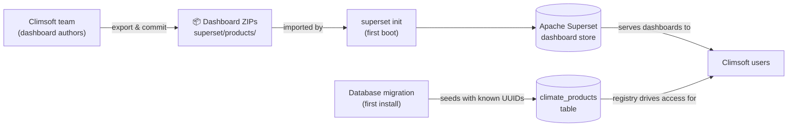
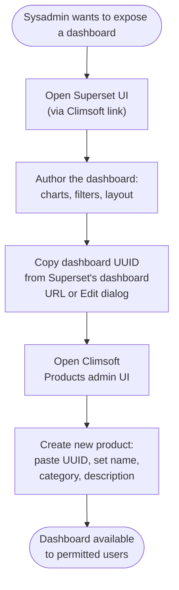
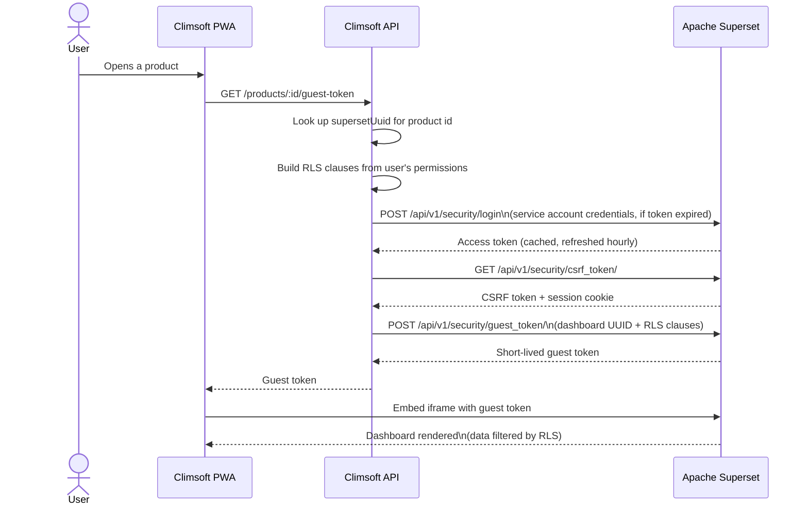
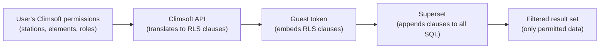

# Climsoft Web Products — How Products Are Authored and Delivered
# Overview

> **In one line:** Apache Superset is the authoring layer; Climsoft manages the registry and controls access; the user sees a live, personalised dashboard without ever logging into Superset.

---

## 1. Why products exist

Climsoft Web's core is built around data: collecting it, quality-controlling it, and storing it reliably. Visualisation is a different concern — and a highly variable one. The charts a meteorological service in one country considers essential may be entirely wrong for another. Humidity-focused coastal products, temperature-extreme products, drought indices — these are institution-specific by nature.

Building every visualisation type directly into Climsoft's core would:
- Introduce institution-specific code into a shared, multinational platform.
- Require core platform changes — a pull request, a release, a redeploy — every time a new product type is needed.
- Create a maintenance surface that grows without bound as more countries contribute more product types.

The answer is the same as for adapters: **keep the core focused, and make the irregular part pluggable.** Apache Superset serves as the analytics layer. It handles the hard engineering of interactive visualisation — chart types, cross-filters, caching, map layers — while Climsoft handles three things Superset alone cannot: the registry (what products exist and which are active), the access control (who can see what data), and the embedding (surfacing products inside the Climsoft PWA as a seamless experience).

---

## 2. Two kinds of products

Climsoft Web distinguishes two types of products:

| | Shipped | Custom |
|---|---|---|
| **Authored by** | Climsoft development team | Institution sysadmin |
| **Delivered via** | Dashboard ZIPs bundled in the repository, imported at first boot | Sysadmin authors in the Superset UI, then registers the UUID in Climsoft |
| **Registered by** | Automatic — a migration seeds the products table at first install | Manual — sysadmin fills in the Climsoft Products admin UI |
| **Can be deleted** | No — protected by `systemKey`; can only be disabled | Yes |

Shipped products are the defaults every installation gets out of the box. Custom products are the institution's own work on top of that foundation.

---

## 3. How shipped products are delivered

The Climsoft team authors a dashboard in Superset, exports it as a ZIP, and commits that ZIP to the repository under `superset/products/`. When `superset init` runs at first boot, it imports each ZIP into Superset — preserving the UUID embedded in the ZIP metadata, so the UUID is stable and known in advance.

A parallel migration seeds the `climate_products` table with one row per shipped product, storing that known UUID alongside the name, category, description, and `systemKey`. From that point on, every user of that installation has those dashboards available without any further sysadmin action.



The UUID is pinned in the ZIP export, not generated at import time. That is what makes the migration's pre-seeded UUID correct: the same dashboard always lands under the same UUID regardless of when or where the import happens.

---

## 4. How custom products are authored and registered

A sysadmin who wants to expose a dashboard they have built in Superset goes through a two-stage process: author first, register second.



Climsoft does not discover or sync dashboards from Superset automatically. The sysadmin is the bridge: they decide which of their Superset dashboards belong in the Climsoft product registry, and they carry the UUID from one system to the other. Everything else — rendering, filtering, caching — is Superset's responsibility once the UUID is registered.

> **Why UUID and not dashboard title?** Titles can be changed by any Superset user with edit access; a UUID is stable for the lifetime of the dashboard. Using the UUID means a renamed dashboard keeps working without touching the Climsoft products table.

---

## 5. How users access products

When a Climsoft user opens a product, they do not log into Superset. They see a live, interactive dashboard rendered inside the Climsoft PWA, scoped to exactly the data they are permitted to see. The mechanism is Superset's **embedded SDK and guest token API**.



The Climsoft API authenticates with Superset using the **`climsoft_service`** machine account — a dedicated service identity separate from any human sysadmin account. The access token is cached in memory and reused for up to 55 minutes; it is fetched fresh only when it is close to expiry. The guest token issued to the browser is short-lived and single-use.

---

## 6. Row-level security

The guest token carries a set of **RLS clauses** — SQL WHERE conditions that Superset appends to every query the dashboard runs. This is how a single shared dashboard definition becomes a personalised one: the same charts serve every user, but each user's token constrains what rows Superset's queries return.



An RLS clause is a plain SQL condition string, for example:

```sql
station_id IN ('00037', '00041', '00055')
```

Superset injects this into the WHERE clause of every SQL query the dashboard executes against Climsoft's database. The user cannot bypass it: the token is opaque to the browser, and Superset enforces the clauses server-side before any rows are returned.

Because RLS is built from the user's Climsoft permissions at token-generation time, no Superset-side user management is needed for end users. Creating or revoking a Climsoft account is sufficient; Superset never stores the user's identity.

---

## 7. Design principles

- **Climsoft manages the registry; Superset manages the dashboards.** The `climate_products` table records what exists and whether it is active. Everything about how a dashboard looks and what data it queries lives in Superset. Neither system tries to replicate the other's job.

- **Users never interact with Superset directly.** The guest-token model means Superset's UI is an authoring tool for sysadmins, not an interface for end users. End users interact only with embedded dashboards inside the Climsoft PWA, already scoped to their permissions.

- **Shipped products are stable by UUID.** The UUID is fixed at authoring time and committed with the ZIP. The migration seeds that known UUID. Nothing in the delivery chain generates a UUID at runtime, so there is no installation-time coordination problem.

- **The service account is a machine identity, not a shared sysadmin account.** `climsoft_service` exists solely for the API's programmatic use. Sysadmins have their own Superset accounts. The two are never the same, so a sysadmin password rotation does not break the API, and Superset's audit logs can distinguish human actions from API actions.

- **Disable, don't delete, for shipped products.** A shipped product carries a `systemKey` that marks it as platform-managed. Sysadmins can hide it from users by toggling `disabled`, but they cannot remove it from the registry. This keeps the products table consistent across upgrades.

---

## Glossary

| Term | Meaning |
|---|---|
| **Product** | A Superset dashboard registered in the Climsoft `climate_products` table and surfaced to users through the Climsoft PWA. |
| **Shipped product** | A product pre-authored by the Climsoft team, delivered as a dashboard ZIP in the repository, and auto-registered at first install. Identified by a non-null `systemKey`. |
| **Custom product** | A product authored by an institution sysadmin in Superset and manually registered in Climsoft by pasting the dashboard UUID. |
| **Dashboard UUID** | The stable identifier Superset assigns to a dashboard. Fixed in the ZIP export for shipped products; copied from the Superset UI for custom products. Stored in the `climate_products` table as `superset_uuid`. |
| **`systemKey`** | An internal Climsoft slug (e.g. `stations_overview`) marking a row as a shipped product. Null for custom products. Prevents deletion and links the table row to its migration-seeded entry across upgrades. |
| **Guest token** | A short-lived, opaque token issued by Superset's `/api/v1/security/guest_token/` endpoint. The PWA passes it to the embedded Superset iframe; Superset enforces its embedded RLS clauses on every query the dashboard executes. |
| **RLS clause** | A SQL WHERE condition string embedded in a guest token (e.g. `station_id IN ('00037', '00055')`). Superset appends all clauses to every query, scoping the result set to what the requesting user is permitted to see. |
| **`climsoft_service`** | The machine service account the Climsoft API uses to authenticate with Superset. Created automatically during `superset init`. Never shared with human sysadmins. |
| **Embedded SDK** | The Superset JavaScript SDK used by the Climsoft PWA to mount a dashboard as an iframe, passing the guest token for authentication and RLS enforcement. |
