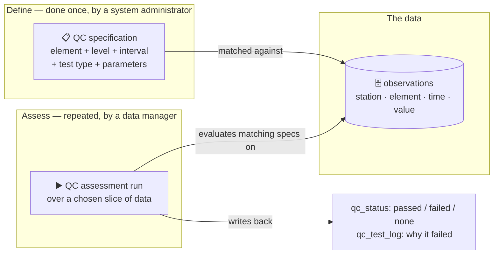
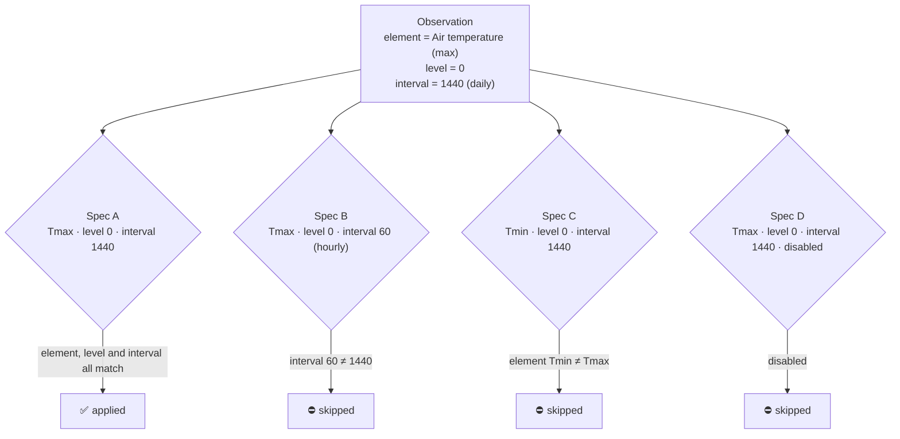
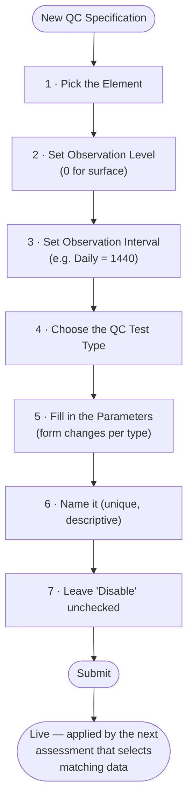
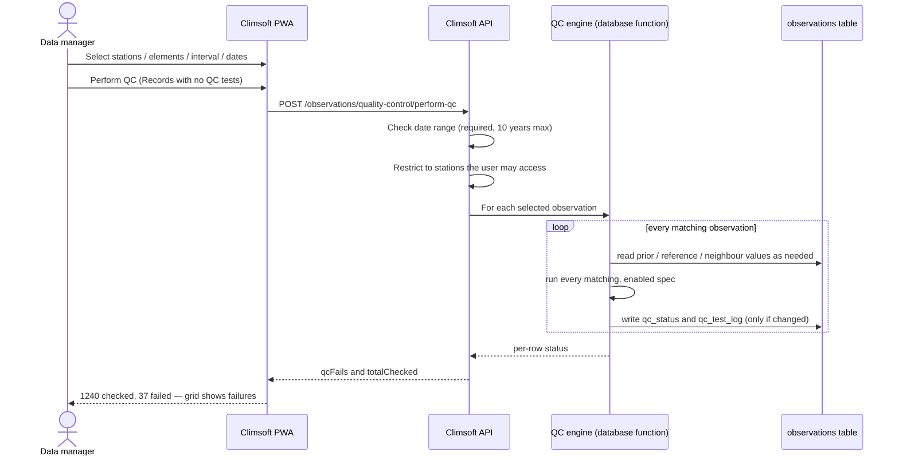
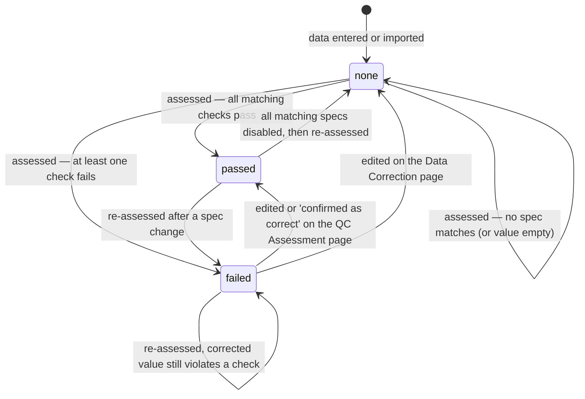
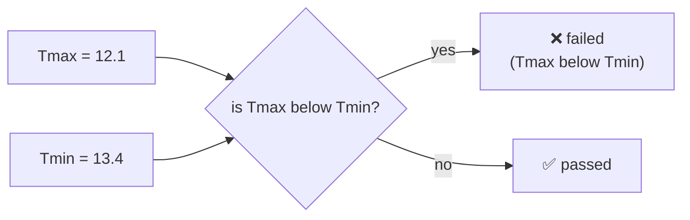
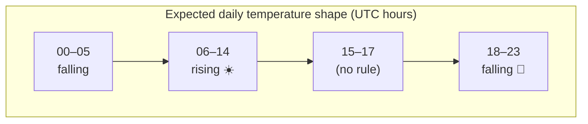
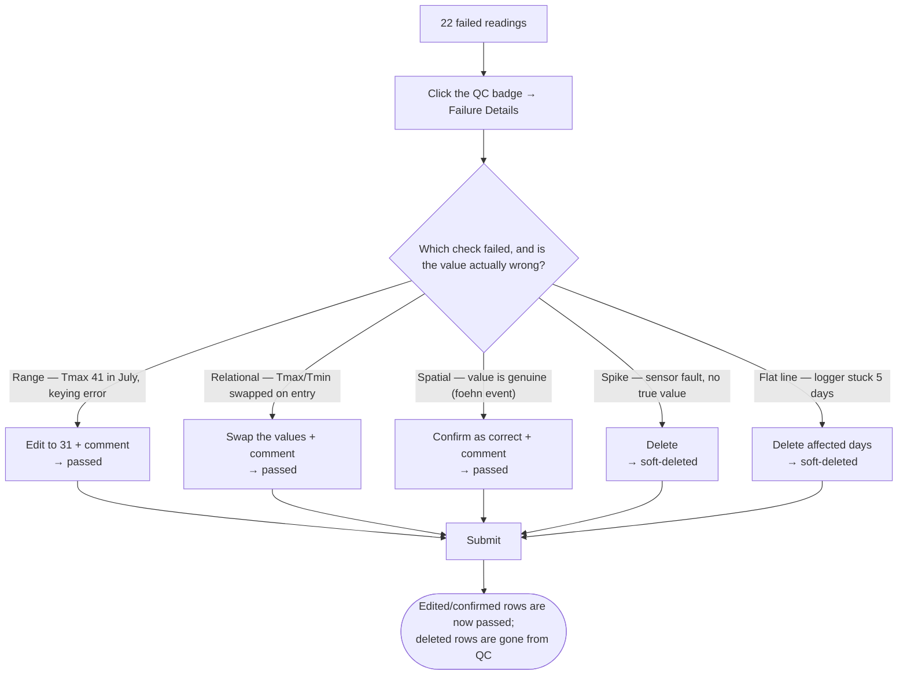
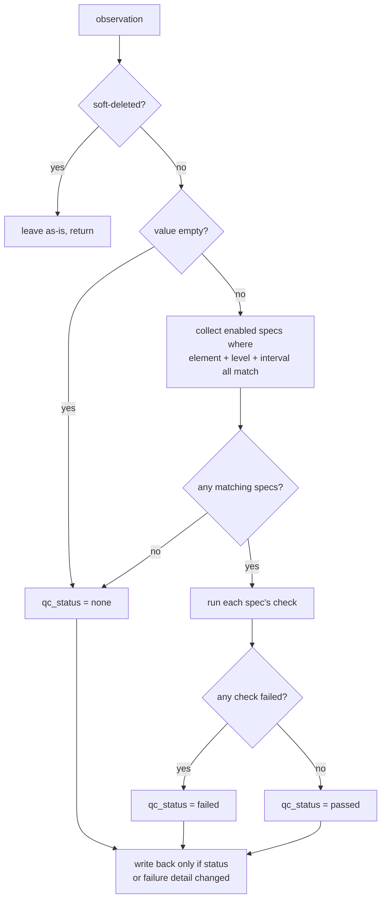

# Climsoft Web Quality Control — Specifications and Assessments
# Overview

*A guide for data managers: what a Quality Control (QC) specification is, how element **interval**
and **level** together decide where it applies, the checks available today, and how
to run an assessment and act on the results.*

> **In one line:** you describe a check once as a **QC specification** (this
> element, at this interval, at this level, must behave like *this*); later you
> run an **assessment** over a slice of data, and Climsoft stamps every reading
> `passed`, `failed`, or `none` and records *why*.

---

## 1. Why QC specifications exist

Quality control on climate and hydrological data is a set of small, repeatable
questions asked of every reading:

- Is this daily maximum temperature physically possible for this station in July?
- Has this rain gauge reported the exact same value for six days straight?
- Did this pressure reading jump 40 hPa from the previous observation?
- Is today's maximum temperature actually *below* today's minimum?

None of these need code. Each is a **rule with a few numbers** — a plausible
range, a spike threshold, a reference element to compare against. Climsoft Web
lets a data manager write each rule once, in the web User Interface (UI), as a **QC
specification**. The rule is stored as JSON. A database function evaluates it
against observations on demand.

The design goal is the same as for [adapters](https://github.com/climsoft/climsoft-web/discussions/316)
and [products](https://github.com/climsoft/climsoft-web/discussions/318): **keep
the core simple and make the variable part configuration, not code.** The checks
themselves are fixed, developer-authored building blocks; what varies between
institutions — which elements, which thresholds, which stations — is data you
enter in a form.

---

## 2. The two-part model: specifications vs assessments

Climsoft separates *defining* a check from *running* it.



| | QC specification | QC assessment |
|---|---|---|
| **Who** | System administrator | Any user with rights to the stations |
| **Where** | **Metadata → QC Specifications** | **Quality Control → QC Assessment** |
| **How often** | Set up once, revised occasionally | Run whenever new data arrives, or after corrections |
| **Effect** | Nothing on its own — it just sits there waiting to match | Reads every selected observation, runs the matching specs, records the outcome |

A specification produces **no result until an assessment is run**. Uploading or
entering data does **not** trigger QC automatically — assessment is always a
deliberate action.

---

## 3. Anatomy of a QC specification

Every specification has the same shape regardless of test type:

| Field | Meaning |
|---|---|
| **Element** | Which observed quantity this rule is about (e.g. *Air temperature (maximum)*). Element IDs are institution-specific — you pick from the Element selector. |
| **Observation level** | The vertical reference of the reading. `0` for standard surface observations; a non-zero value for upper-air levels, soil depths, etc. |
| **Observation interval** | The measurement period **in minutes**: `60` = hourly, `1440` = daily, `44640` = monthly, and so on. |
| **QC test type** | One of the seven checks in §7. |
| **Parameters** | The numbers the chosen test needs — thresholds, a reference element, time-of-day periods, a search radius. |
| **Name** | A unique label. Shows up in failure details, so make it descriptive: *"Tmax daily plausible range — coastal stations"*. |
| **Disabled** | A toggle. A disabled specification is skipped by every assessment. Use it to retire a rule without deleting it. |
| **Comment** | Free text for your own notes. |

### 3.1 The matching rule — element, level, **and** interval must all agree

This is the part that most often surprises people.

When an assessment evaluates an observation, it collects the specifications to
apply with an **exact three-way match**:

```
specification applies  ⟺  spec.element   = observation.element
                       AND spec.level     = observation.level
                       AND spec.interval  = observation.interval
                       AND spec.disabled  = false
```



Consequences you need to plan for:

- **An hourly range check will never touch daily data, and vice versa.** If your
  station reports both hourly *and* daily temperature, and you want both
  quality-controlled, you need **two specifications** — one at interval `60`, one
  at interval `1440` — even if the plausible range is identical. There is no
  "any interval" wildcard.
- The same is true across **levels**. A soil-temperature range check written at
  level `0` will not apply to a reading stored at level `10` (cm).
- The interval is **not** guessed from the data. It is whatever value the
  import/entry specification assigned to the observation. If your data was
  ingested with interval `1440`, your QC spec must say `1440`.
- Changing an existing spec's element, level, or interval silently changes which
  data it covers on the next run. It does **not** retroactively un-stamp data it
  used to cover.

> **Rule of thumb:** think of a specification as targeting a *stream* —
> "daily maximum temperature at the surface" — not just an element. The element
> names the quantity; the interval and level name the stream.

---

## 4. Creating a QC specification

**Metadata → QC Specifications → New QC Specification.** Creating, editing, and deleting
specifications requires a **system administrator** account. (Reading them, and
running assessments, does not.)



Notes:

- The parameter form **changes when you change the test type** — each type in §7
  has its own set of inputs.
- A test type that has **no engine implementation yet** (currently *Remote
  sensing consistency*) is rejected on save with a clear message. The other seven
  are fully supported.
- There is no "test against sample data" button. Validate a new specification by
  running an assessment over a small, known slice (a single station, a few days)
  and inspecting the failures.

---

## 5. Running a quality control assessment

**Quality Control → QC Assessment.**

1. Use the **query selection** panel to narrow the data: stations, elements,
   level, interval, and a **date range** (required). The date can be filtered on
   the observation time or on the entry time.
2. Click **Perform QC**. In the dialog, choose which records to (re-)assess:
   - **All records** in the selection
   - **Records with no QC tests** (`qc_status = none`) — the usual choice for new data
   - **Records that failed** / **Records that passed** — to re-check a subset
3. Submit. Climsoft evaluates every matching observation and reports
   `N observations checked, M failed`.
4. The grid reloads filtered to **failed** records for review.



Constraints and behaviour:

- **Date range is mandatory** and capped at **10 years** per run. For long
  historical back-fills, run it in slices (e.g. year by year).
- The run only ever touches **stations you are authorised for**.
- **Soft-deleted observations are never assessed**, and never counted as a
  neighbour, previous value, or reference by any test.
- A reading whose **value is empty** is set to `qc_status = none` (nothing to
  check) rather than `failed`.
- Re-running over unchanged data that produces the same result **writes nothing**
  — no needless churn, and the "who last touched this" stamp only moves when the
  status or the failure detail actually changes.

### What each status means



- **none** — not checked, or nothing to check (no matching spec, or the value is empty)
- **passed** — every matching check passed, **or** a data manager vouched for the value on the QC Assessment page
- **failed** — at least one matching check failed

> Note the two ways out of `failed`: the **QC Assessment page** sets `passed`
> directly (the reviewer is asserting the value is acceptable), while the
> **Data Correction page** sets `none` (the edit will be re-checked on the next
> run). §6 explains why.

---

## 6. Reviewing and acting on results

After a run, the QC Assessment grid lists the **failed** readings. Each row has:

- the value and flag, **editable in place**;
- a **comment** field (via the value's extra-info control);
- the failed **QC test badges** — click one to open the **QC Test Failure
  Details** dialog, which shows the specification name and type, the observed
  value, the thresholds / reference values / neighbour statistics in play, and a
  plain-language statement of the violation (e.g. *"Above upper threshold by
  6.2"*, or *"12.1 < 13.4 evaluated to TRUE"*);
- two row actions — **Confirm as correct** and **Delete** — plus **Confirm All**
  / **Delete All** for the whole page.

For each failed reading the data manager does one of three things, then clicks
**Submit**:

| Action | What it means | Effect on `qc_status` |
|---|---|---|
| **Edit** the value / flag | The reading was wrong; here is the right value | → **`passed`** |
| **Confirm as correct** | The reading is fine; the QC rule was too strict for this case | → **`passed`** |
| **Delete** | The reading is unusable and has no correct value | soft-deleted (unchanged elsewhere) |

### Why "passed" and not "none"

The QC Assessment page submits corrections and confirmations to a **dedicated
endpoint** (`/observations/data-entry-qc`) that stamps every affected reading
`qc_status = passed`. This is deliberate: on this page the data manager has
**looked at the failure and vouched for the value**, so it should not resurface
as "unchecked" on the next run.

This is different from the **Data Correction page** (*Data Ingestion → Data
Correction*), whose edits go to `/observations/data-entry` and reset
`qc_status = none` — an edit made there is *not* a QC judgement, so it is left to
be re-checked.

| | Data Correction page | QC Assessment page |
|---|---|---|
| Endpoint | `/observations/data-entry` | `/observations/data-entry-qc` |
| An **edit** sets `qc_status` to | `none` (will be re-assessed) | `passed` (accepted) |
| "Confirm as correct" (no edit) | not available | available → `passed` |
| **Delete** | soft delete | soft delete — identical |

> ⚠️ **Always add a comment when you edit or confirm on the QC Assessment page.**
> You are overriding a QC result by hand; the comment is the only record of *why*
> — "value corrected against the paper register", "coastal foehn event, reading
> genuine", "sensor drift confirmed, kept pending recalibration". The system does
> not force a comment, so make it a team rule. (Deletions carry their own audit
> trail and need no special treatment.)

The failure detail (`qc_test_log`) is **not** wiped when you confirm or correct
here — it lingers on the row until the next assessment recomputes it. That is
harmless: a now-`passed` reading no longer appears in the failed-records view.

> **Failure detail is only as good as the last run.** Older data
> quality-controlled before failure-context logging will show *"Detailed context
> is not available — re-run QC"*. Re-running fills it in.

---

## 7. The QC test types

Seven checks are implemented today. Each subsection gives: **what it asks**, its
**parameters**, **when it flags a reading as failed**, what it does when it can't
decide, and a worked example on one or two elements.

Any single check has three possible outcomes for a reading: **fail**, **pass**,
or **not applicable** (it declined to run — wrong station, no neighbours, hour
outside every diurnal period). A reading's overall `qc_status` is `failed` if any
matching check failed, `passed` if at least one ran and none failed, and `none`
if *every* matching check was not applicable (or there were no matching specs, or
the value is empty).

Throughout, the examples use two surface daily elements — **Air temperature
(maximum)** and **Air temperature (minimum)**, both at **level 0**, **interval
1440** — and, once, **Precipitation** and **Relative humidity**. Element IDs
shown (`101`, `102`, …) are illustrative; use your own.

| Test type | One-line purpose | Needs other data? |
|---|---|---|
| Range threshold | Value within a plausible min–max | No |
| Flat line | Value not stuck/repeating | Earlier readings, same stream |
| Spike | No implausible jump from the previous reading | Previous reading, same stream |
| Relational comparison | One element vs another at the same time | Reference element, same time |
| Contextual consistency | Two elements implausible *together* | Reference element, same time |
| Diurnal | Follows the expected daily rise/fall | Previous reading, same stream |
| Spatial consistency | Agrees with nearby stations | Neighbouring stations, same time |
| *Remote sensing consistency* | *(planned — not yet implemented)* | — |

---

### 7.1 Range threshold

**Asks:** is the value between a lower and an upper bound?

**Parameters**

| Parameter | Meaning |
|---|---|
| `allRangeThreshold` `{ lowerThreshold, upperThreshold }` | One range used for every month. |
| **or** `monthsThresholds` — 12 pairs, January…December | A separate range per calendar month (climatologically tighter). |
| `stationIds` *(optional)* | If set, the check applies **only** to these stations. Leave unset for all stations in the stream. |

You provide **either** a single all-months range **or** the 12 monthly ranges,
not both.

**Fails when:** `value < lowerThreshold` **or** `value > upperThreshold` (for the
observation's month, if monthly ranges are used).

**Not applicable when:** the specification lists `stationIds` and the
observation's station is not among them.

> ⚠️ If neither `allRangeThreshold` nor a usable monthly pair resolves for a
> reading, the check quietly *passes*. Always fill the range in fully.

**Example — daily maximum temperature, monthly ranges**

Element *Air temperature (maximum)* (`101`), level `0`, interval `1440`.
For an inland highland station, plausible Tmax by month might be:

| Month | lower | upper | | Month | lower | upper |
|---|---|---|---|---|---|---|
| Jan | 12 | 32 | | Jul | 8 | 26 |
| Feb | 13 | 33 | | Aug | 9 | 28 |
| Mar | 13 | 33 | | Sep | 11 | 31 |
| Apr | 12 | 31 | | Oct | 12 | 32 |
| May | 10 | 29 | | Nov | 12 | 31 |
| Jun | 8 | 27 | | Dec | 12 | 31 |

A July reading of `29.5` fails (`29.5 > 26`). The same value in October passes.

> **Why monthly beats all-months here:** a single all-year range wide enough to
> allow a hot October day (`32`) would let an impossible cold-season value through.
> Monthly ranges catch "plausible value, wrong season".

---

### 7.2 Flat line

**Asks:** has the value stopped changing across several consecutive readings?

**Parameters**

| Parameter | Meaning |
|---|---|
| `consecutiveRecords` (≥ 2) | How many readings in a row must be "equal" to flag — including the current one. |
| `flatLineThreshold` | How close counts as "equal": readings within ± this of the current value are treated as unchanged. |
| `excludeRange` `{ lowerThreshold, upperThreshold }` *(optional)* | A value band to ignore. |

The check looks back at the **`consecutiveRecords − 1` readings immediately
before** this one, in the same stream (same station, element, level, interval),
skipping soft-deleted rows.

**Fails when:** *every* one of those previous readings is within
`flatLineThreshold` of the current value (so with `consecutiveRecords = 6`, the
current value plus the 5 before it are all effectively identical).

**Passes when:** there aren't enough previous readings yet (start of a series),
or the current value falls inside `excludeRange`.

**Example — a stuck rain gauge**

Element *Precipitation* (`110`), level `0`, interval `1440`.

- `consecutiveRecords`: `6`
- `flatLineThreshold`: `0` (exact repetition)
- `excludeRange`: `{ lowerThreshold: 0, upperThreshold: 0 }` — **ignore genuine
  dry spells**, which legitimately report `0.0` for many days.

Now six consecutive days of `0.0` do **not** flag (excluded), but six consecutive
days of `12.7` — a classic tipping-bucket fault — do.

> **Why `excludeRange` matters for rainfall:** without it, every dry season would
> be one giant flat-line failure. Exclude the value that is *supposed* to repeat.

---

### 7.3 Spike

**Asks:** did the value jump too far from the reading right before it?

**Parameters**

| Parameter | Meaning |
|---|---|
| `spikeThreshold` | Maximum allowed absolute change between one reading and the next. |

**Fails when:** `| value − previousValue | ≥ spikeThreshold`, where
`previousValue` is the **immediately preceding reading** in the same stream
(soft-deleted rows skipped).

**Passes when:** there is no previous reading.

> ⚠️ "Previous" means the previous *record*, not "24 hours earlier". If there is a
> gap in the series, the spike test compares across the gap. Choose
> `spikeThreshold` with the interval in mind.

**Example — daily minimum temperature**

Element *Air temperature (minimum)* (`102`), level `0`, interval `1440`,
`spikeThreshold`: `15`.

Day-to-day Tmin rarely moves more than a few degrees. A jump from `14.0` to
`29.5` (`|29.5 − 14.0| = 15.5 ≥ 15`) fails — very likely a keying error or a
sensor fault.

---

### 7.4 Relational comparison

**Asks:** does this element stand in a forbidden relationship to another element
measured at the same station and the same time?

**Parameters**

| Parameter | Meaning |
|---|---|
| `referenceElementId` | The other element to compare against. |
| `condition` | One of `>` `<` `=` `>=` `<=`. |

The reference value is looked up at the **same station, level, interval, and exact
date-time** (the data source is ignored). If either value is missing, the reading
passes.

> **Read the condition as the *violation*, not the valid state.** The check fails
> when `observedValue <condition> referenceValue` is **TRUE**. You are describing
> the situation that should never happen.

**Fails when:** `observedValue <condition> referenceValue` evaluates TRUE.

**Passes when:** no reference value exists at that exact timestamp, or either
value is empty.

**Example — maximum vs minimum temperature**

Physical law: daily Tmax must be ≥ daily Tmin. The violation is *Tmax < Tmin*.

Put the specification **on the Tmax element**:

- Element: *Air temperature (maximum)* (`101`), level `0`, interval `1440`
- `referenceElementId`: `102` (*Air temperature (minimum)*)
- `condition`: `<`  → *"fail when Tmax < Tmin"*

A day with Tmax `12.1` and Tmin `13.4` fails: `12.1 < 13.4` is TRUE. The failure
detail reads *"12.1 < 13.4 evaluated to TRUE"*.



> ⚠️ Reference matching is on **exact timestamp**. Daily Tmax and Tmin must carry
> the same nominal observation time for this to work. If several values exist for
> the reference element at that instant (multiple sources), one is picked
> arbitrarily.

---

### 7.5 Contextual consistency

**Asks:** are two elements each individually plausible, but **implausible when
they occur together**?

**Parameters**

| Parameter | Meaning |
|---|---|
| `referenceElementId` | The second element. |
| `primaryCheck` `{ condition, value }` | A condition on **this** element's value. |
| `referenceCheck` `{ condition, value }` | A condition on the **reference** element's value. |

Both are evaluated at the same station/level/interval/exact date-time.

**Fails when:** `primaryCheck` is TRUE **and** `referenceCheck` is TRUE — both at
once.

**Passes when:** no reference value at that timestamp, or either value is empty,
or only one of the two conditions is met.

**Example — rain reported while humidity is very low**

Measurable rainfall with very dry air at the same time is physically
inconsistent — usually one of the two sensors or entries is wrong.

Put the specification **on Precipitation**:

- Element: *Precipitation* (`110`), level `0`, interval `1440`
- `primaryCheck`: `condition` `>`, `value` `1` → *rainfall exceeded 1 mm*
- `referenceElementId`: `111` (*Relative humidity*)
- `referenceCheck`: `condition` `<`, `value` `40` → *humidity below 40 %*

A day with `4.2 mm` of rain **and** `31 %` humidity fails (both TRUE). `4.2 mm`
with `88 %` humidity passes (only the primary condition holds).

> **Contextual vs relational:** relational compares the two values directly
> (`A < B`); contextual tests each value against **its own fixed threshold** and
> flags only the forbidden *combination*.

---

### 7.6 Diurnal

**Asks:** at this hour of day, is the value moving in the direction the daily
cycle expects?

**Parameters**

| Parameter | Meaning |
|---|---|
| `periods` — one or more `{ trend, startHour, endHour, tolerance }` | Time-of-day windows and the expected direction of change. |
| `trend` | `rising` (value should increase) or `falling` (value should decrease). |
| `startHour`, `endHour` | Hours `0`–`23`, inclusive. If `startHour > endHour` the window **wraps past midnight** (e.g. `18`–`5` covers 18:00–23:00 and 00:00–05:00). |
| `tolerance` | Allowed movement against the trend before flagging. `0` = strict. |

The check compares the reading with the **immediately preceding reading** in the
same stream and looks at the **change**. Hours are read in the **database
timezone (UTC)** — see the caveat below.

**Fails when:**
- in a `rising` window: `value − previousValue < −tolerance` (it dropped too much), or
- in a `falling` window: `value − previousValue > tolerance` (it rose too much).

**Skips (not applicable) when:** the reading's hour falls in none of the
`periods`, or there is no previous reading.

**Example — hourly air temperature**

Element *Air temperature* (`120`), level `0`, **interval `60` (hourly)** —
diurnal only makes sense on sub-daily data.

```
periods:
  { trend: "rising",  startHour: 6,  endHour: 14, tolerance: 0.5 }
  { trend: "falling", startHour: 18, endHour: 5,  tolerance: 0.5 }
```



At 10:00 the previous hour was `22.0 °C` and this hour is `20.0 °C`:
change `−2.0`, which is `< −0.5` in a *rising* window → **fails**.
At 20:00, `28.0 → 26.5 °C` (change `−1.5`) in a *falling* window → passes.
At 16:00 there is no rule → the test is skipped for that reading.

> ⚠️ **Timezone.** Observation times are stored in UTC and the hour is extracted
> in UTC. If your local solar day peaks at 14:00 local and your station is at
> UTC+3, the "rising" window in local terms is roughly 03:00–11:00 **UTC** —
> define the `periods` accordingly.
>
> ⚠️ Like spike, "previous reading" is the previous *record*. A gap in hourly data
> means the comparison straddles the gap.

---

### 7.7 Spatial consistency

**Asks:** does this station's value agree with what nearby stations reported for
the same element at the same time?

**Parameters**

| Parameter | Meaning |
|---|---|
| `maxDistanceKm` | Search radius for neighbouring stations. |
| `minNeighbours` | Minimum neighbours with data required to run the check. |
| `maxDeviation` | Maximum allowed distance of this value from the neighbours' mean. |

Neighbours are found with a true geographic distance search (PostGIS) on station
locations, matching the **same element, level, interval, and exact date-time**,
excluding this station, empty values, and soft-deleted rows.

**Fails when:** `| value − neighbourMean | > maxDeviation`.

**Skips (not applicable) when:** this station has **no location** set, or fewer
than `minNeighbours` neighbours have data at that timestamp.

**Example — daily maximum temperature network check**

Element *Air temperature (maximum)* (`101`), level `0`, interval `1440`.

- `maxDistanceKm`: `50`
- `minNeighbours`: `3`
- `maxDeviation`: `5`

Station A reports `45.2 °C`. Three stations within 50 km report `24.8`, `25.0`,
`25.5` → mean `25.1`, deviation `20.1 > 5` → **fails**. If only two neighbours had
data, the check is skipped (not enough evidence).

> **Prerequisite:** spatial consistency is only as useful as your station
> coordinates. Stations with no location are silently skipped. In a sparse
> network, keep `minNeighbours` low (2–3) and `maxDistanceKm` generous, or the
> check will almost always skip.

---

## 8. Worked end-to-end example

**Goal:** a basic daily-temperature QC suite for one station network.

**Streams:** *Air temperature (maximum)* (`101`) and *Air temperature (minimum)*
(`102`), both **level 0**, **interval 1440**.

### Step 1 — author the specifications (admin, Metadata → QC Specifications)

| # | Name | Element | Level | Interval | Type | Key parameters |
|---|---|---|---|---|---|---|
| 1 | Tmax daily plausible range | 101 | 0 | 1440 | Range threshold | 12 monthly `{lower, upper}` pairs |
| 2 | Tmin daily plausible range | 102 | 0 | 1440 | Range threshold | 12 monthly `{lower, upper}` pairs |
| 3 | Tmax not below Tmin | 101 | 0 | 1440 | Relational comparison | `referenceElementId: 102`, `condition: <` |
| 4 | Tmax day-to-day spike | 101 | 0 | 1440 | Spike | `spikeThreshold: 12` |
| 5 | Tmin day-to-day spike | 102 | 0 | 1440 | Spike | `spikeThreshold: 12` |
| 6 | Tmax stuck sensor | 101 | 0 | 1440 | Flat line | `consecutiveRecords: 5`, `flatLineThreshold: 0` |
| 7 | Tmax network agreement | 101 | 0 | 1440 | Spatial consistency | `maxDistanceKm: 75`, `minNeighbours: 3`, `maxDeviation: 6` |

Seven specifications, two streams. Note every row repeats `level 0` and
`interval 1440` — that is the matching key, not an afterthought. If this network
also produced **hourly** temperature, none of these would touch it.

### Step 2 — run the assessment (data manager, Quality Control → QC Assessment)

1. Query selection: the station network, elements `101, 102`, level `0`,
   interval `1440`, date range = the last month.
2. **Perform QC → "Records with no QC tests" → Submit.**
3. Result: *"1 860 checked, 22 failed"*. Grid shows the 22.

### Step 3 — triage, in the grid

Work each failed row; **add a comment** to every row you edit or confirm.



Because this is the QC Assessment page, the edited and confirmed rows are stamped
`passed` on submit — they will not reappear as "unchecked". Re-run QC over the
slice only if you also changed a **specification** in the meantime.

---

## 9. Good practice

- **Name specifications for humans.** The name is what a reviewer sees next to a
  failure. *"Tmax not below Tmin"* beats *"QC test 14"*.
- **One stream, many small checks.** Prefer several narrow specifications (range,
  spike, relational) over one clever rule. Each failure then points at a specific
  problem.
- **Mind the interval on every spec.** Duplicate a rule for each interval the
  element is reported at. There is no wildcard.
- **Exclude the value that is meant to repeat** in flat-line checks (rainfall `0`,
  sunshine `0` at night).
- **Write relational/contextual conditions as the violation.** *"Fail when Tmax
  is below Tmin"*, not *"Tmax should be at or above Tmin"*.
- **Set thresholds from your own climatology**, ideally monthly. Borrowed numbers
  from another country's network will over- or under-flag.
- **Disable, don't delete**, a rule you are unsure about — you keep its history
  and can bring it back.
- **Comment every hand override.** On the QC Assessment page, an edit or a
  "confirm as correct" sets `qc_status = passed` by human decision — the comment
  is the only record of the reasoning. Make it a team rule.
- **Re-run after a *specification* change** (new rule, new threshold, enable /
  disable) so `qc_status` reflects the current rules. Edits and confirmations
  made on the QC Assessment page are already `passed` and need no re-run; edits
  made on the Data Correction page return to `none` and are picked up by the next
  run.
- **Roll large back-fills in slices** (≤ 10 years per run; a year at a time is
  comfortable).
- **Give stations coordinates** if you want spatial consistency to do anything.

---

## 10. How it works under the hood (for the curious)

An assessment calls one database function, `func_execute_qc_tests`, once per
selected observation:



- Each check is a small SQL function (`func_perform_range_threshold_test`,
  `func_perform_spike_test`, …). Adding a new check type is a developer task: a
  new function plus a branch in the dispatcher and the test-type list.
- A check returning "not applicable" (wrong station for a station-scoped range,
  no neighbours, hour outside all diurnal periods) contributes nothing — it
  neither passes nor fails.
- Failure detail is stored per reading as `qc_test_log` (JSON): the test id,
  status, and a context object with the numbers behind the decision. That is what
  the failure dialog renders.
- QC results are **not** versioned per run. The row carries only its latest
  `qc_status` and `qc_test_log`. A run-level audit trail (who ran what, when) is
  planned separately.
- `qc_status` can also be set **without** running the engine: the QC Assessment
  page's save endpoint (`/observations/data-entry-qc`) writes `passed` directly
  for every reading a data manager edits or confirms. It does not touch
  `qc_test_log`, so a manually-passed row keeps its last failure detail until the
  next real assessment overwrites it.

---

## Glossary

| Term | Meaning |
|---|---|
| **QC specification** | A stored rule: one element, at one level and interval, checked by one test type with its parameters. Authored in *Metadata → QC Specifications*. Called `qc_tests` in the database. |
| **QC assessment / run** | The act of evaluating matching specifications over a selected slice of observations, from *Quality Control → QC Assessment*. |
| **Stream** | An (element, level, interval) combination — e.g. "surface daily maximum temperature". A specification targets exactly one stream. |
| **Observation level** | Vertical reference of a reading. `0` = standard surface. Non-zero for upper air, soil depths, etc. Part of the matching key. |
| **Observation interval** | Measurement period in minutes (`60` hourly, `1440` daily, `44640` monthly). Part of the matching key. |
| **`qc_status`** | Per-reading outcome: `none` (unchecked / nothing to check), `passed` (all matching checks passed, **or** a data manager confirmed the value on the QC Assessment page), `failed` (≥ 1 matching check failed). |
| **`qc_test_log`** | Per-reading JSON detail of the most recent assessment — which checks ran, which failed, and the numbers behind each decision. |
| **Reference element** | A second element a relational or contextual check compares against, matched at the same station / level / interval / exact time. |
| **Not applicable** | A check that declined to run for a reading (station out of scope, no neighbours, hour outside all diurnal periods). Contributes neither pass nor fail. |
| **Disabled specification** | A specification skipped by every assessment. A soft "off switch" that preserves the rule and its history. |
